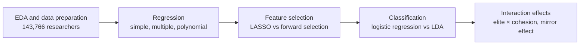
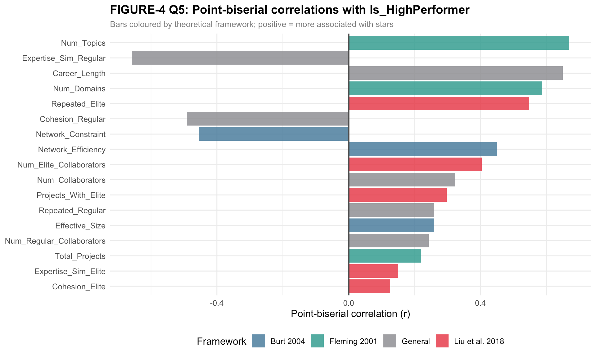
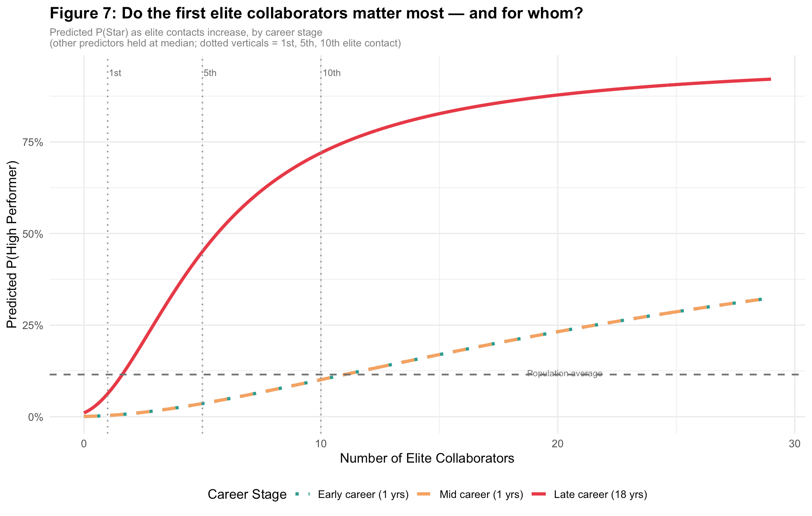
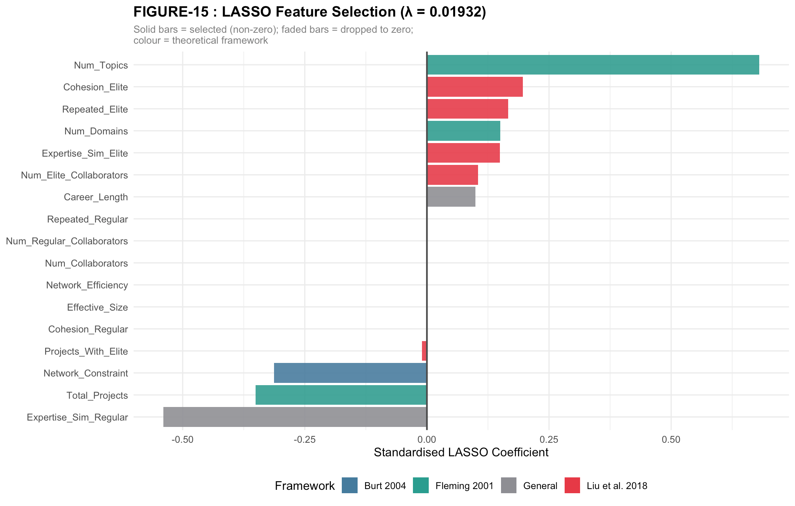
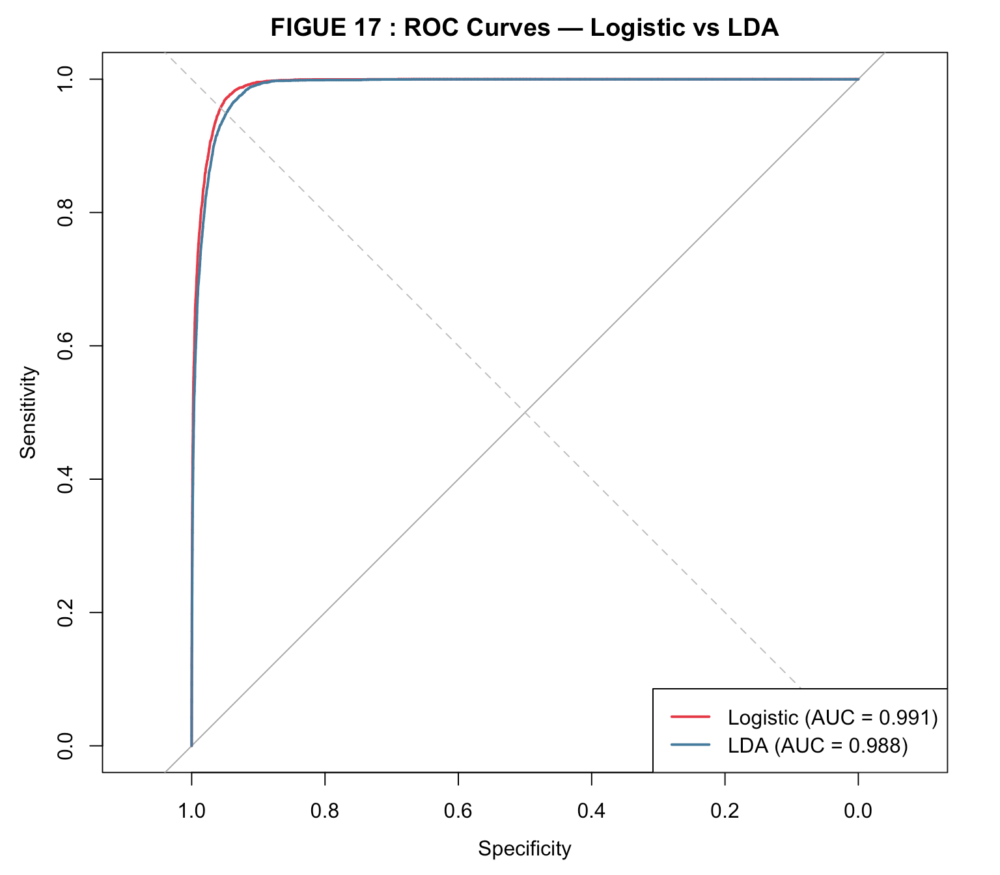
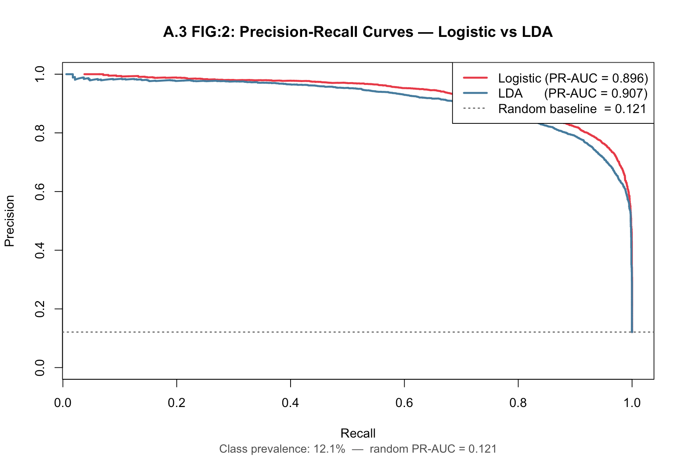
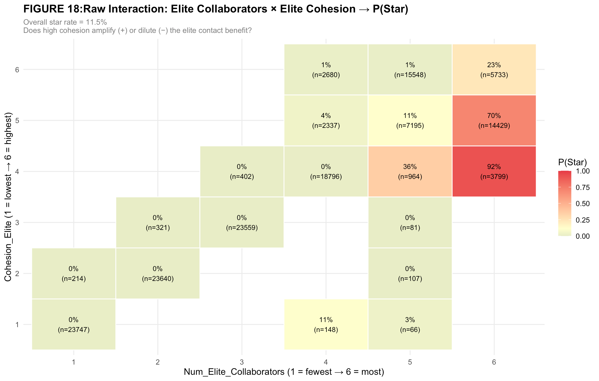
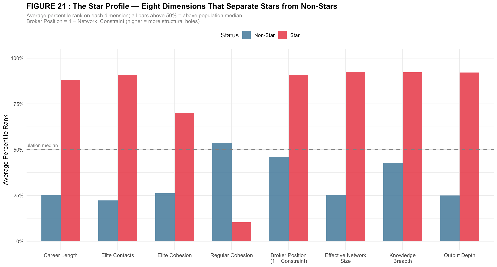

# Predicting Star Researchers in Collaboration Networks

**MSc Business Analytics: Advanced Analytics and Machine Learning, Assignment 1 (2026)**
**Author:** Ria Goel  ·  **Tools:** R Markdown · glmnet · caret · MASS · pROC · ROCR · car · boot · ggplot2 · kableExtra

> Scientific output is highly unequal: a small group of "star" researchers produces a large share of high-impact work. Using data on **143,766 researchers**, this project asks **which collaboration patterns separate the 11.5% of stars from everyone else**: working with elite researchers, bridging separate groups (brokerage), or having broad expertise?

---

## Key results at a glance

| | Result |
|---|---|
| **Best classifier** | Logistic regression (threshold 0.2): **95.6% recall**, 75.2% precision, 95.7% accuracy, **ROC-AUC 0.991** |
| **Alternative** | LDA: higher precision (86.3%) but lower recall (78.4%), ROC-AUC 0.988. PR-AUC is 0.896 (logistic) vs 0.907 (LDA), against a 0.121 random baseline |
| **Regression** | Multiple regression R² = **0.65**. LASSO CV-MSE **1.556** vs 2.094 for full OLS |
| **Strongest driver** | Elite collaborators: the share of researchers who are stars rises from **0.1% with no elite ties to 83.1% with more than 10** |
| **Key interaction** | Too much cohesion among elite contacts reduces their value (coefficient −0.153, OR 0.858, p < 2e-16). With many elite contacts, star probability is **92% at low cohesion vs 23% at high cohesion** |
| **Mirror effect** | Cohesion among elite collaborators helps (+5.36), while cohesion among regular collaborators hurts (−9.18) |

---

## Theory being tested
- **Liu et al. (2018):** collaborating with elite researchers passes on tacit, high-impact skills.
- **Burt (2004):** people who bridge disconnected groups (brokers) gain access to non-redundant information.
- **Fleming (2001):** researchers who combine deep expertise with breadth produce more innovation.
- **Merton (1968):** the Matthew effect, where early advantages accumulate over time.

## Approach



1. **Data preparation:**
   - Missing elite-network values were set to **zero**, because they mean the researcher has no elite ties, not that data is missing.
   - The impact measure was log-transformed, cutting skewness from 284 to 0.35.
   - Pairs of predictors with correlations above 0.7 were flagged (for example, r = −0.996 between `Cohesion_Regular` and `Network_Efficiency`).
2. **Regression:** simple, multiple and polynomial models, with residual diagnostics, VIF checks for overlapping predictors, and **standardised coefficients** to compare effect sizes.
3. **Feature selection:** **LASSO** (10-fold CV) compared with greedy **forward selection**. Both methods agree on 11 variables.
4. **Classification:**
   - Stratified 70/30 train/test split.
   - **Logistic regression** and **LDA** compared.
   - A threshold sweep (0.1–0.9) chose 0.2 to prioritise recall, because only 11.5% of researchers are stars (class imbalance).
   - Models compared on ROC-AUC, precision, recall and F1.
5. **Interaction effects:** elite collaborators × elite cohesion, tested with likelihood-ratio tests, heatmaps and predicted-probability curves, plus a formal test of the **mirror effect**.

## Results

**Elite exposure dominates: the first few elite collaborators give the steepest gain, especially early in a career.**

 

**LASSO keeps 12 of 17 predictors. Topic breadth has the largest positive effect, and similarity with regular collaborators the largest negative effect.**



**Classification: both models separate stars well. Logistic regression is preferred because it catches more stars (higher recall) at the chosen threshold.**

| Model | Accuracy | Precision | Recall | ROC-AUC | PR-AUC |
|---|---|---|---|---|---|
| **Logistic regression** (threshold 0.2) | 95.7% | 75.2% | **95.6%** | **0.991** | 0.896 |
| LDA | 95.9% | **86.3%** | 78.4% | 0.988 | **0.907** |

 

**Interaction: many elite contacts help most when those contacts are *not* a tight clique.**



**The star profile: stars rank high on elite exposure, brokerage, breadth and output, and low on cohesion among regular collaborators.**



## Recommendations for researchers
1. **Build ties with elite researchers.** This gives the largest return of any networking investment.
2. **Spread those ties across separate communities**, since a tight elite clique quickly becomes redundant.
3. **Keep investing in breadth across topics.**
4. **Avoid heavy reliance on tight networks of regular peers**, which lowers impact regardless of productivity.

## Repository structure
```
├── README.md
├── code/
│   └── star_performance_analysis.Rmd   # Full analysis: EDA → regression → LASSO → classification → interactions
├── figures/                            # Key figures from the final report
└── report/
    └── Star_Researcher_Report.pdf      # Full knitted report (33 pages)
```

## How to run
The analysis is a reproducible R Markdown document with a fixed random seed. The dataset was provided by the module team and is not redistributed here. Place the CSV named in the `DATA_PATH` line in the same folder, then **Knit**.

## Skills demonstrated
`R` · `R Markdown` · `linear & polynomial regression` · `regression diagnostics` · `VIF / multicollinearity` · `LASSO` · `forward selection` · `cross-validation` · `logistic regression` · `LDA` · `ROC-AUC` · `class imbalance & threshold tuning` · `interaction effects` · `likelihood-ratio tests` · `network analytics`

---

*Related project from the same module: [Predicting citation impact of biomedical research](https://github.com/riagoel11/citation-impact-prediction-ml-r)*
